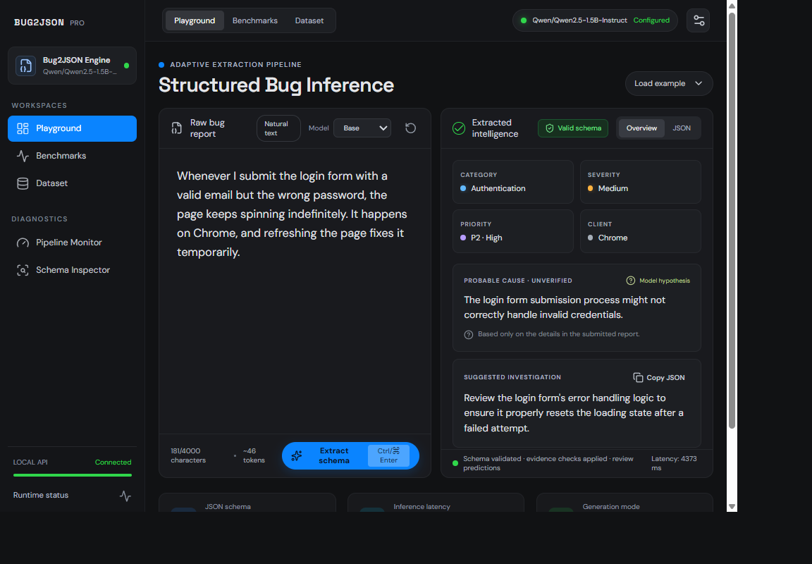

# Bug2JSON

Bug2JSON turns a software bug report into a small, reviewable JSON record. The project is designed to compare an untouched base model with a human-reviewed LoRA fine-tune. Severity and probable cause are hypotheses, not verified incident facts.

## Output contract

Every analysis contains exactly these fields:

| Field | Meaning |
| --- | --- |
| `category` | One of the categories defined in `backend/app/schemas.py`, or `unknown` |
| `severity` | `critical`, `high`, `medium`, `low`, or `unknown` |
| `priority` | `P1`–`P4`, or `unknown` |
| `environment` | A browser, OS, device, or runtime explicitly identified in the report; otherwise `unknown` |
| `reproducible` | `true`, `false`, or `unknown` |
| `probable_cause` | A cautious hypothesis or `unknown` |
| `suggested_action` | One concise investigation step |

The API validates every response against this schema. It also replaces environments
not named in the report and unsupported reproducibility claims with `unknown`.
Critical severity is retained only when the report contains critical-impact
evidence; an explicit workaround downgrades an unsupported critical prediction to
medium, otherwise severity and priority become `unknown`. The UI keeps the JSON
visible and asks reviewers to verify predictions before acting.

## Live inference screenshot



This screenshot was captured from a real local request to the base
`Qwen/Qwen2.5-1.5B-Instruct` model. The displayed 4,373 ms is one request's
observed latency, not a performance benchmark. No LoRA adapter has been trained
and no reviewed held-out evaluation has been run, so accuracy and improvement
figures are **not measured**. The example output is a demonstration, not evidence
of model accuracy.

## Project layout

- `src/`: React/TypeScript interface
- `backend/`: FastAPI API and lazy-loaded inference service
- `data/`: illustrative examples and labeling policy
- `training/`: group-safe data preparation, LoRA SFT, and base-vs-adapter evaluation

Bundled examples are synthetic and marked `reviewed: false`. They are examples of the data format, not training truth. The preparation script excludes them.

## Run locally

Use Python 3.11 or 3.12 for the training environment, and Node.js 20 or newer for the interface. From this directory:

```powershell
python -m venv .venv
.\.venv\Scripts\Activate.ps1
python -m pip install -r backend\requirements.txt
npm install
```

Start the API and interface in separate terminals:

```powershell
.\.venv\Scripts\python.exe -m uvicorn app.main:app --app-dir backend --reload
npm run dev
```

Open the Vite URL printed in the terminal (usually `http://localhost:5173`). The interface and API start without downloading a model. To run an analysis, select **Base model · baseline** or train and install an adapter first. The first model run downloads the configured base model and may require a GPU or substantial RAM.

Model analysis also requires the model runtime dependencies from
`training\requirements.txt`. Install them in an environment suited to your
PyTorch/CUDA setup before running analyses; the API and UI can be explored without
those large dependencies, but inference will return a clear unavailable response.

Run the backend and data-pipeline tests with:

```powershell
python -m pip install -r backend\requirements-dev.txt
.\.venv\Scripts\python.exe -m pytest
```

Optional local configuration can be copied from `.env.example`. `BUG2JSON_BASE_MODEL` selects the Hugging Face model ID; `BUG2JSON_ADAPTER_PATH` sets the adapter directory.

## Build a trustworthy dataset

Read [`data/labeling-guidelines.md`](data/labeling-guidelines.md) before labeling. Add one JSON object per line to a private or reviewed dataset, using:

```json
{"input":"The report text","output":{"category":"authentication","severity":"medium","priority":"P2","environment":"Chrome","reproducible":true,"probable_cause":"The loading state may not reset after login fails","suggested_action":"Handle failed login responses and reset the loading state"},"source":"synthetic","group_id":"login-failure-spinner","reviewed":true}
```

Use a stable `group_id` for related incidents and paraphrases. Do not include secrets or personal data. Public issue reports must be checked for repository license and terms. Do not treat automatically generated labels as ground truth.

After at least 30 human-reviewed examples across at least three distinct issue
groups are available:

```powershell
.\.venv\Scripts\python.exe training\prepare_data.py --input data\reviewed_reports.jsonl
```

The script validates labels, filters unreviewed rows and duplicates, and keeps each `group_id` in a single 80/10/10 train/validation/test split. Keep the test set fixed and do not tune on it.

## Fine-tune with LoRA

Training dependencies are separate from the app dependencies. Install them in a Python 3.11/3.12 GPU environment (for example, a Colab GPU runtime):

```powershell
python -m pip install -r training\requirements.txt
python training\train.py --base-model Qwen/Qwen2.5-1.5B-Instruct
```

The trainer masks the prompt loss, trains LoRA adapters, evaluates on the validation split each epoch, and saves the best adapter under `models/bug2json-lora`. For the default UI setting, make the adapter available at that path or set `BUG2JSON_ADAPTER_PATH`.

## Evaluation

Compare base and fine-tuned predictions on the same held-out test set:

```powershell
python training\evaluate.py --test data\splits\test.jsonl
```

The report includes JSON validity, schema validity, category macro-F1, per-field exact match, and all-fields exact match. Review probable-cause and suggested-action usefulness, unsupported claims, and ambiguous reports manually. Include representative successes and failures when publishing results.

The current starter does not claim a trained adapter or measured improvement. The first milestone is creating a consistent, reviewed dataset; the next is comparing the baseline and fine-tuned adapter on an untouched test split.
